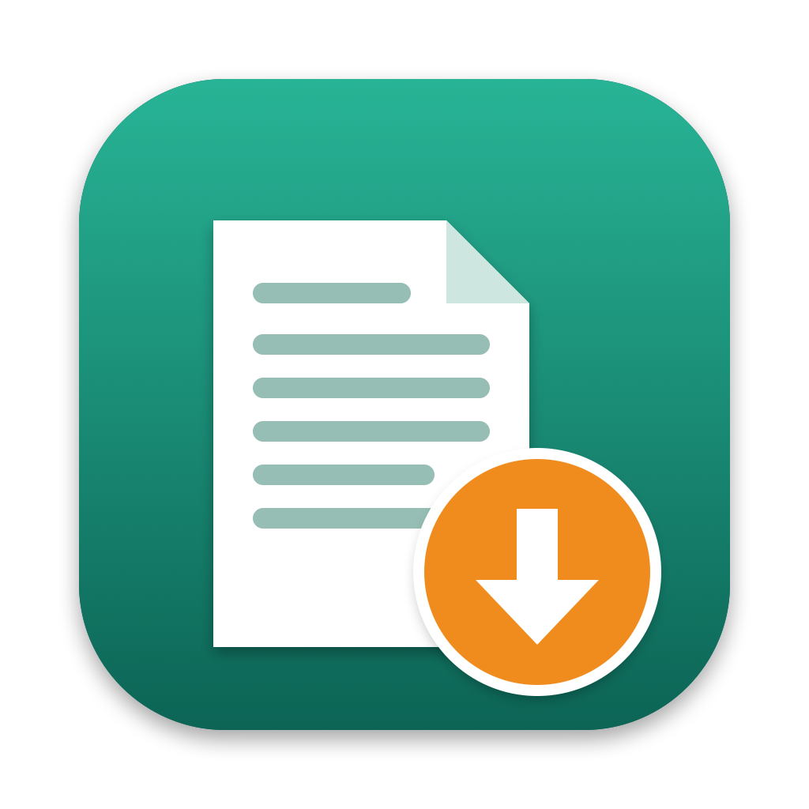

<p align="center">
  
</p>

# Scan to me

A native macOS app that scans paper documents on your network scanner. It turns each scan into a searchable PDF, gives it a meaningful file name and files it in a local folder.

```text
26-11-14_IN_CityPower_Annual-statement_a3f9c2.pdf
```

The app needs no server, no cloud storage and no account. Your documents stay on your Mac unless you choose cloud recognition with Claude.

## Features

- **Scan over Wi-Fi.** The app speaks eSCL (AirScan) over HTTPS. It works with the flatbed and with the automatic document feeder (ADF).

- **Manual duplex.** Scan the fronts, flip the stack, scan the backs. The app puts the pages back in the right order. This works even if your feeder only scans one side.

- **Blank page detection.** Blank pages are set aside, never deleted silently.

- **Searchable PDFs.** Text recognition (Apple Vision) runs on your Mac. The text is embedded as an invisible layer, so Spotlight finds your documents.

- **Content recognition and naming.** The app suggests the document type, sender, a short title and the document date. You can edit every suggestion before filing.

- **Batch splitting.** A stack of several letters is split into separate documents. This needs Claude. You can adjust split points by hand, and a printable separator sheet is included.

- **Import PDFs and images.** Drag files into the window, including straight from the Photos app. PDF pages that already contain text are kept unchanged.

- **Recognize later.** You can rename documents that were filed without recognition afterwards.

- **German and English user interface.**

## Recognition modes

| Mode | What happens | Data leaves your Mac? | Cost |
| --- | --- | --- | --- |
| **Off** | The name is built from the scan date, the word "Scan" and a short ID. | No | Free |
| **Local** | Apple's on-device language model suggests the name. Requires macOS 27 with Apple Intelligence turned on. Accuracy is lower than with cloud models, so check names before filing. | No | Free |
| **Claude** | Scanned pages are sent to Anthropic's Claude API. This is the only mode that can split batches. | Yes | Roughly US$0.01 per document, using your own API key |

The app never switches from Local to Claude on its own. The main window always shows which mode is active.

## File names

A file name is built from these parts:

| Part | Meaning | Example |
| --- | --- | --- |
| Date | year, month, day | `26-11-14` |
| Type | kind of document | `IN` |
| Sender | who sent the document | `CityPower` |
| Title | short description | `Annual-statement` |
| ID | six random characters, so names never collide | `a3f9c2` |

The ID is always part of the name. Under Settings → File name you can choose:

- the order of the parts;

- a two- or four-digit year;

- whether date parts are joined with hyphens.

**Built-in types:**

| Type | English UI | German UI |
| --- | --- | --- |
| Letter | LT | BR |
| Invoice | IN | RE |
| Medical | MD | AZ |
| Unknown | UN | UB |

You can add up to three custom types with a short description, for example `TX` for "Everything from the tax office".

Amounts, account numbers and diagnoses never go into file names.

## Requirements

- A Mac with Apple silicon and macOS 14 or later. Local recognition needs macOS 27.

- A network scanner that supports eSCL over HTTPS, on the same network as the Mac.
  - The reference device is the Epson WF-2960 (flatbed and single-sided feeder).
  - Other eSCL scanners should work, because the app reads each scanner's capabilities from the device itself. They have not been tested.

- Optional: an [Anthropic API key](https://console.anthropic.com/) for recognition with Claude.

## Installation

The app is not notarized. The steps below build it yourself; you can also install a zip someone built for you.

1. Build the app (see [Building from source](#building-from-source)). If you received a zip instead, unpack it.
2. Move "Scan to me" into Applications.
3. Open the app. macOS will say it cannot verify the developer.
4. Go to System Settings → Privacy & Security and click "Open Anyway".

The setup assistant then walks you through four steps:
1. Choose the language and the scanner, then make a test scan. The scanner's certificate is pinned at this point.
2. Enter your Anthropic API key. You can skip this step.
3. Choose the storage folder. The default is `~/Documents/Scan-to-me`.
4. Set up file names and document types.

You can change everything later in Settings (⌘,).

## Privacy and security

- **Scanner connection.** The app talks only to the scanner whose self-signed certificate was pinned during setup (SHA-256 of the leaf certificate).

- **API key.** The key is stored in the macOS Keychain, never in files or logs.

- **What is sent.** Documents are sent only when the mode is "Claude". "Off" and "Local" send nothing.

- **No data loss.** Existing files are never overwritten. Deleting always asks first and moves files to the Trash.

- **Diagnostic log.** The log at `~/Library/Logs/Scan-to-me/scanner.log` records requests and status codes. It never records document content.

## Troubleshooting

- **No scanner found.** Make sure the Mac is on the same network. Then enter the scanner's address by hand, for example `EPSON123456.local` or its IP address.

- **Scan pauses mid-batch.** Some scanners, including the WF-2960, pause for about two minutes during feeder scans. The app waits up to five minutes per page.

- **"Local" cannot be selected.** The app shows the reason next to the option, for example that macOS is too old, that Apple Intelligence is off, or that the model is still downloading.

- **Finding the log.** Settings → Scanner → "Show log in Finder".

## Building from source

The project is a Swift package without an Xcode project. It uses Swift and SwiftUI and has no third-party dependencies. The Claude Messages API is called directly via `URLSession`.

```sh
cd ScanToMe
swift test                 # unit tests; live tests are skipped unless their environment variables are set
./build-app.sh             # builds "build/Scan to me.app" with an ad hoc signature
ditto -c -k --keepParent "build/Scan to me.app" build/Scan-to-me.zip   # zip for distribution
```

| Path | Contents |
| --- | --- |
| `ScanToMe/Sources/ScanCore/` | All logic, covered by tests: eSCL client, PDF building, recognition, naming, filing |
| `ScanToMe/Sources/ScanToMeApp/` | SwiftUI user interface, kept thin |
| `ScanToMe/Support/` | Info.plist and app icon |

### Live tests

Live tests run against real hardware or APIs. They are skipped unless you set their environment variables:

| Variable | What it tests | Notes |
| --- | --- | --- |
| `LIVE_SCANNER_HOST=<host>` | Your scanner | Certificate and capabilities only; no scan is started |
| `LIVE_ANTHROPIC_KEY=<key>` | The Claude API | Synthetic documents only; costs a few cents |
| `LIVE_APPLE_MODEL=1` | Apple's on-device model | Free; works offline |

## Contributing

Issues and pull requests are welcome, especially:

- test reports from other eSCL scanners;

- translations.

Please keep the logic in `ScanCore` with tests, and keep the UI thin.

## License

[MIT](LICENSE)
